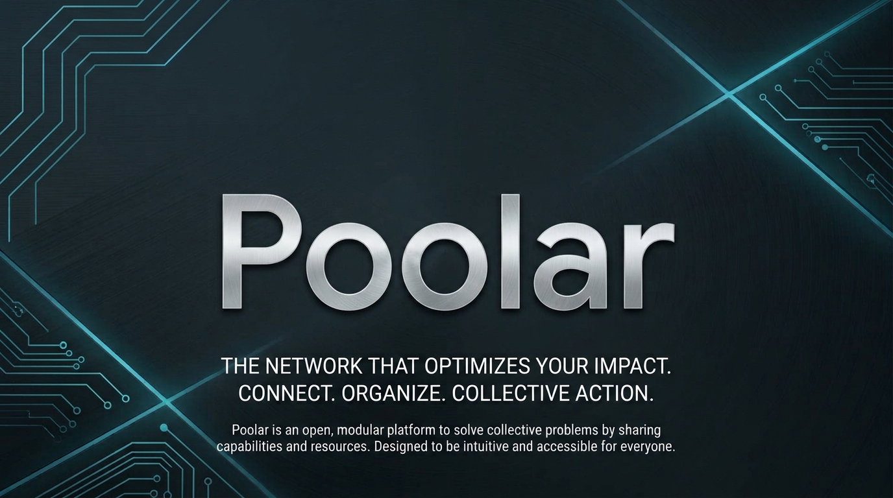
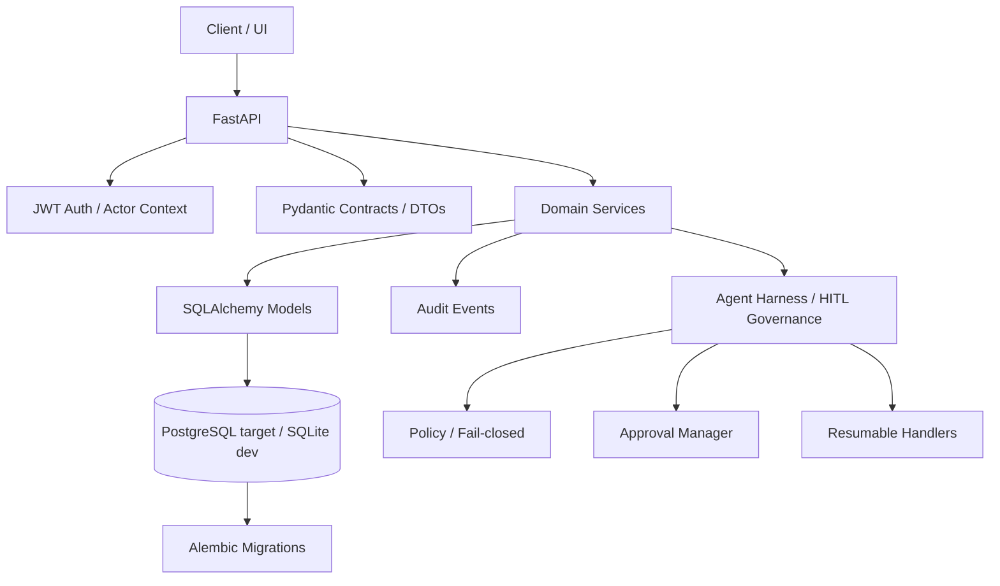
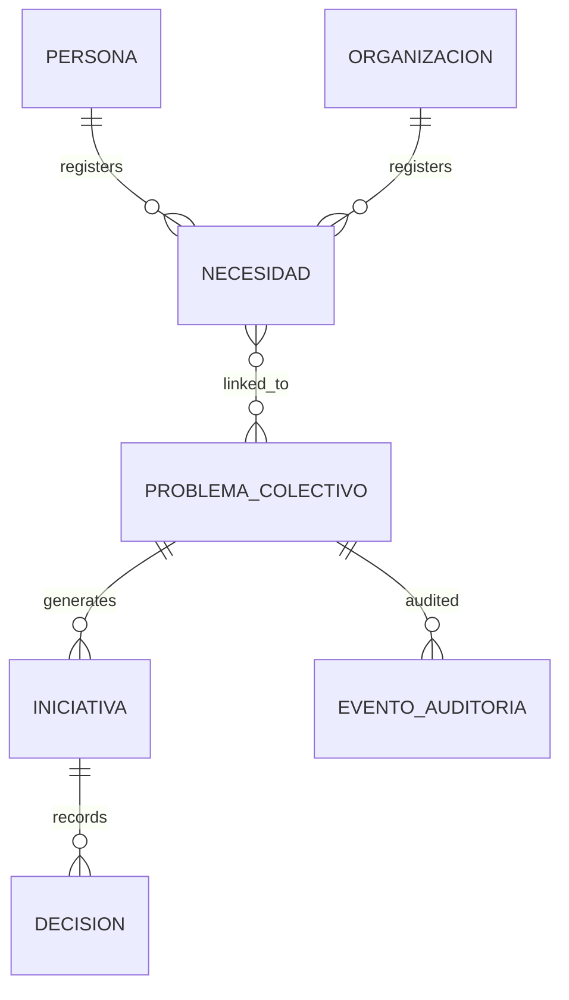
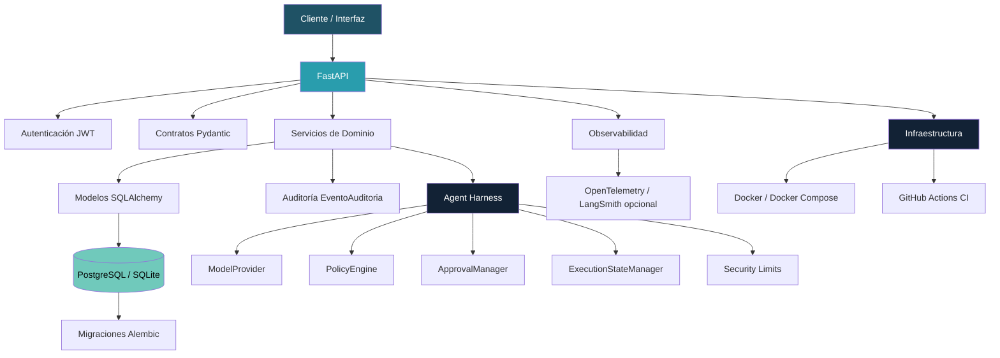
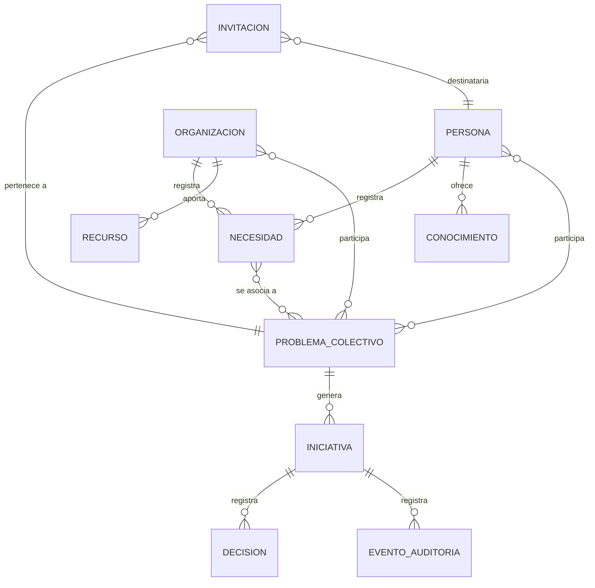
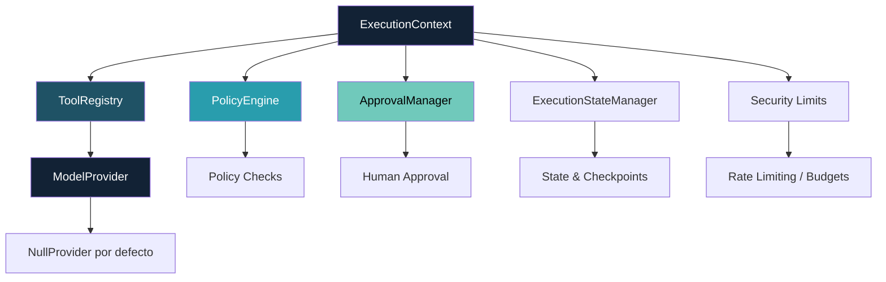

# POOLAR — Cooperation Infrastructure

<p align="center">
  
</p>

<p align="center">
  <strong>Connect needs. Organize capabilities. Build shared solutions.</strong>
</p>

<p align="center">
  <a href="#what-is-poolar">What is Poolar</a> ·
  <a href="#how-it-works">How it works</a> ·
  <a href="#architecture">Architecture</a> ·
  <a href="#domain-model">Domain</a> ·
  <a href="#governance-and-hitl-agent-harness">Governance</a> ·
  <a href="#project-status">Status</a> ·
  <a href="#installation-and-execution">Installation</a> ·
  <a href="#documentation">Docs</a>
</p>

<p align="center">
  
  
  
  
  
  
</p>

> **Language:** English is the default for this repository. A Spanish version is available below. See [`docs/CONVENTIONS.md`](docs/CONVENTIONS.md).

---

## What is Poolar

**Poolar** is an open, modular, interoperable infrastructure for collective cooperation.

It is not a social network, a task manager, or a listings portal. It is the layer that enables people, communities, associations, cooperatives, small businesses, and institutions to:

1. **Identify** individual and shared needs.
2. **Discover** collective problems.
3. **Connect** capabilities, knowledge, and resources.
4. **Organize** initiatives and shared solutions.
5. **Document** decisions and responsibilities.
6. **Execute** coordinated actions (with governance/HITL where required).
7. **Measure** results and generate reusable learning.

The fundamental unit is not the user, organization, task, or project. It is **the problem that needs a response** and the **collective capability** that can be assembled to address it.

## The problem it addresses

Needs, knowledge, and resources are often fragmented. Discovering shared problems, validating collective needs, and organizing action requires discovery, validation, aggregation, decision-making, coordination, and traceability. Poolar provides operational primitives for this process in an open, transparent, and reusable way.

## How it works

Operational cycle:

```
Need → Discovery → Collective Problem → Capabilities & resources → Alternatives → Decision → Execution → Results → Reusable learning
```

Typical flow: register needs, discover deterministic matches, review/accept relations, create a Collective Problem, identify capabilities, compare alternatives, document decisions, execute or resume governed actions, record outcomes, and export the case.

## Architecture



**Layers:** UI → FastAPI API → Domain services → Domain models/persistence → Governance/Agent Harness (HITL, approvals, resumable handlers, audit). Analytics is separated (read-only, post-transactional).

## Domain model

Core entities include: `Persona`, `Organizacion`, `Necesidad`, `ProblemaColectivo`, `Iniciativa`, `Decision`, `Invitacion`/participation, `ConocimientoCapacidad`, `RecursoAporte`, `EventoAuditoria`, and HITL `ApprovalRequest`.



## Governance and HITL (Agent Harness)

- **Fail-closed** by default (missing context/permission/scope/evidence/handler ⇒ block or deny).
- **Scope/tenant isolation** (organization/personal), no cross-tenant leakage, no self-approval.
- **State flow:** `pending` → (authorized approval) → `executing` → `executed`; `pending` → reject/withdraw → `rejected`; handler failure → rollback → `failed_retryable`; `executed` is terminal/idempotent.
- **POOLAR retains authority:** external modules/providers propose; they do not receive execution authority.

See [`GOBERNANZA_POOLAR.md`](GOBERNANZA_POOLAR.md), [`docs/modelo_autorizacion.md`](docs/modelo_autorizacion.md), [`FASE0_CHECKLIST_CIERRE.md`](FASE0_CHECKLIST_CIERRE.md).

## Project status

- **Stage:** prototype / development, **not production**. No verified impact claims without evidence.
- **Phase 0:** core controls strong; **formal closure gated** (CI green, PG job with managed secrets, exhaustive authz/E2E/fault-injection as required).
- **Local evidence (2026-11-10, no PG):** `python -m pytest -q --rootdir=.` → **171 passed, 7 skipped, 1 xfailed** (SQLite). PG-only tests are deterministically skipped with reachability guards; prior disposable-PG evidence exists for migrations/concurrency (revalidate in target/CI env).
- **Data:** `synthetic_pilot` by default.

## Analytics / Lakehouse (separated)

Medallion foundation `raw → staging → marts` (read-only, no HITL effects): idempotent/redacted export (`scripts/export_medallion_raw.py`), synthetic samples, dbt stubs, and local DuckDB build (`analytics/build_local_lakehouse.py`). Strategic evolution contemplated: `auditable exports → (Basin/Pipelines → R2/Iceberg)` when enabled. See [`docs/ANALYTICS_LAKEHOUSE.md`](docs/ANALYTICS_LAKEHOUSE.md).

## Tech stack

Python 3.11+, FastAPI, Pydantic v2, SQLAlchemy, PostgreSQL (target) / SQLite (dev/tests), Alembic, JWT (python-jose) + PBKDF2-SHA256, Pytest, Docker/Compose.

## API and development

Interactive docs when running: Swagger `/docs`, ReDoc `/redoc`, OpenAPI `/openapi.json`.

Key areas: auth (`/personas/registro`, `/auth/token`), needs, collective problems, initiatives/decisions/activities, invitations/participation, matching, approvals (`/approvals/*`), exports, audit events, health.

## Installation and execution

```bash
# Local (dev)
python -m venv .venv
# Windows: .venv\Scripts\activate
pip install -r requirements.txt

cp .env.example .env  # set POOLAR_SECRET_KEY and DATABASE_URL
python -m pytest -q   # local suite (non-PG)
python -m uvicorn src.main:app --reload --port 8000
```

```bash
# Docker Compose
docker-compose up -d db
docker-compose up -d api
alembic upgrade head
```

Optional analytics:

```bash
python scripts/export_medallion_raw.py --out analytics/local/raw
python analytics/build_local_lakehouse.py --raw analytics/local/raw
```

Docs build:

```bash
pip install mkdocs
python -m mkdocs build
```

## Documentation

- **Index (compilable):** [`docs/index.md`](docs/index.md) · `mkdocs.yml` (legacy Fase 0 reports archived in [`docs/archive/fase0/`](docs/archive/fase0/))
- **Conventions (language, contracts):** [`docs/CONVENTIONS.md`](docs/CONVENTIONS.md)
- **Governance/limits:** [`GOBERNANZA_POOLAR.md`](GOBERNANZA_POOLAR.md), [`BOUNDARIES.md`](BOUNDARIES.md), [`INTENT.md`](INTENT.md)
- **Audit/status:** [`AUDIT_READY_POOLAR.md`](AUDIT_READY_POOLAR.md), [`FASE0_CHECKLIST_CIERRE.md`](FASE0_CHECKLIST_CIERRE.md), [`BACKLOG_PRIORIZADO_POOLAR.md`](BACKLOG_PRIORIZADO_POOLAR.md)
- **Architecture/ecosystem:** [`docs/POOLAR_ECOSYSTEM_ARQUITECTURA_INTEGRACION.md`](docs/POOLAR_ECOSYSTEM_ARQUITECTURA_INTEGRACION.md), [`docs/ANALYTICS_LAKEHOUSE.md`](docs/ANALYTICS_LAKEHOUSE.md)

## Known limitations

- Not production; no verified real-world impact claims without evidence.
- Real data/pilots require consent, privacy, and legal/operational controls.
- External module/provider integration requires verified contracts, licenses/IP, security, and governance; modules propose, POOLAR decides/executes under HITL.
- PostgreSQL is the target; SQLite for controlled dev/tests. PG evidence must be revalidated in target/CI environments.

## License

MIT — see [`LICENSE`](LICENSE).

---


<details>
<summary><strong>Español</strong></summary>

> Note: the repository's primary language and convention is English (see `docs/CONVENTIONS.md`). This section is kept as a bilingual reference and may be migrated progressively.

# Poolar — Infraestructura de Cooperación

<p align="center">
  
</p>

<p align="center">
  <strong>Conectar necesidades. Organizar capacidades. Construir soluciones compartidas.</strong>
</p>

<p align="center">
  <a href="#-que-es-poolar">Qué es</a> ·
  <a href="#-como-funciona">Cómo funciona</a> ·
  <a href="#-arquitectura">Arquitectura</a> ·
  <a href="#-modelo-de-dominio">Dominio</a> ·
  <a href="#-api-y-desarrollo">API</a> ·
  <a href="#-instalacion-y-ejecucion">Instalación</a> ·
  <a href="#-estado-del-proyecto">Estado</a>
</p>

<p align="center">
  
  
  
  
  
  
  
</p>

<p align="center">
  <strong>Topics:</strong> poolar, cooperacion, open-infrastructure, collective-problems, fastapi, sqlalchemy, postgresql, python, docker, agent-harness, matching, consent, accessibility
</p>

---

## Índice

- [Qué es Poolar](#-que-es-poolar)
- [El problema que resuelve](#-el-problema-que-resuelve)
- [Cómo funciona](#-como-funciona)
- [Arquitectura](#-arquitectura)
- [Modelo de dominio](#-modelo-de-dominio)
- [Agent Harness](#-agent-harness)
- [Funcionalidades](#-funcionalidades)
- [Escenario demostrativo](#-escenario-demostrativo-logistica-compartida)
- [Tecnologías](#-tecnologias)
- [API y desarrollo](#-api-y-desarrollo)
- [Instalación y ejecución](#-instalacion-y-ejecucion)
- [Estado del proyecto](#-estado-del-proyecto)
- [Documentación](#-documentacion)
- [Limitaciones conocidas](#-limitaciones-conocidas)

---

## Qué es Poolar

**Poolar** es una infraestructura abierta, modular e interoperable para la cooperación colectiva.

No es una red social, ni un gestor de tareas, ni un portal de anuncios. Es la capa que permite a personas, comunidades, asociaciones, cooperativas, pequeñas empresas e instituciones:

1. **Identificar** necesidades individuales y compartidas.
2. **Descubrir** problemas colectivos.
3. **Conectar** capacidades, conocimientos y recursos.
4. **Organizar** iniciativas y soluciones conjuntas.
5. **Documentar** decisiones y responsabilidades.
6. **Ejecutar** acciones coordinadas.
7. **Medir** resultados y generar aprendizajes reutilizables.

La unidad fundamental no es el usuario, la organización, la tarea ni el proyecto. Es **el problema que necesita una respuesta** y la **capacidad colectiva** que podemos reunir para resolverlo.

> Nadie tiene que llegar con una asociación constituida, conocer previamente a los demás ni saber qué aplicación necesita utilizar.

---

## El problema que resuelve

Personas y organizaciones tienen necesidades, conocimientos y recursos dispersos. Descubrir que comparten un problema, validar que existe una necesidad colectiva y organizarse para abordarlo requiere:

- **Descubrimiento**: encontrar a otras personas con necesidades compatibles.
- **Validación**: confirmar que el problema es real y compartido.
- **Agregación**: reunir demanda, capacidades y recursos.
- **Decisión**: comparar alternativas con criterios explícitos.
- **Coordinación**: asignar responsabilidades y ejecutar.
- **Trazabilidad**: registrar lo que se hizo y lo que se aprendió.

Poolar proporciona las herramientas operativas para ejecutar este proceso de forma abierta, transparente y reutilizable.

---

## Cómo funciona

El ciclo operativo de Poolar es:

```
Necesidad → Descubrimiento → Problema Colectivo → Capacidades y recursos → Alternativas → Decisión → Ejecución → Resultados → Aprendizaje reutilizable
```

### Recorrido típico

1. **Persona A** registra una necesidad: "Necesito transporte regular al centro de salud".
2. **Persona B** registra otra: "Necesito entregas para mi comercio".
3. El sistema **descubre coincidencias** potenciales por criterios deterministas (categoría, territorio, capacidades).
4. Se **revisa y acepta** la relación entre necesidades.
5. Se crea un **Problema Colectivo** que agrupa las necesidades.
6. Se **identifican capacidades** disponibles (conocimiento logístico, vehículos, etc.).
7. Se **comparan alternativas** (compartir ruta, agrupar demanda, contratar servicio).
8. Se **toma una decisión** documentada con responsables.
9. Se **registran hitos** de ejecución.
10. Se **mide el resultado** y se **exporta** el expediente.

---

## Arquitectura

### Arquitectura general



**Implementado:** FastAPI, SQLAlchemy, Pydantic, Auth JWT, Servicios, Modelos, Auditoría, Agent Harness (base), Observabilidad (adaptador), Docker, CI.
**Experimental:** Agent Harness (no conectado a flujo operativo), Observabilidad (desactivada por defecto).
**Futuro:** RAG, LangGraph, LangSmith, PostGIS, OR-Tools, MCP.

### Arquitectura de capas

```
┌─────────────────────────────────────────────┐
│  Interfaz (HTML/JS / Futuro: React)          │
├─────────────────────────────────────────────┤
│  API FastAPI (contratos Pydantic)           │
├─────────────────────────────────────────────┤
│  Servicios de Dominio (matching, needs,     │
│  invitation, aggregation, feasibility)      │
├─────────────────────────────────────────────┤
│  Núcleo de Dominio (models.py)              │
│  Persona · Organización · Necesidad ·       │
│  ProblemaColectivo · Iniciativa · Decision  │
│  · Invitacion · Recurso · Conocimiento      │
├─────────────────────────────────────────────┤
│  Persistencia (PostgreSQL / SQLite)         │
│  Migraciones (Alembic)                      │
└─────────────────────────────────────────────┘
```

---

## Modelo de dominio



### Entidades principales

| Entidad | Descripción |
|---|---|
| `Persona` | Participante individual con autenticación propia (`hashed_password`, `rol=individuo`). |
| `Organizacion` | Entidad colectiva con usuarios operativos. |
| `Necesidad` | Necesidad registrada por persona u organización (visibilidad: privada/compartible/pública). |
| `ProblemaColectivo` | Problema compartido que agrupa necesidades (estados: detectado → en_análisis → validado → cerrado). |
| `Iniciativa` | Solución organizada vinculada a un problema colectivo. |
| `Decision` | Decisión tomada con alternativa, motivo, responsable y versión de metodología. |
| `Invitacion` | Invitación persistente con estado (pendiente, aceptada, rechazada, retirada, caducada). |
| `ConocimientoCapacidad` | Conocimiento o capacidad ofrecida por persona u organización. |
| `RecursoAporte` | Recurso o aporte (tiempo, herramientas, materiales, etc.). |
| `EventoAuditoria` | Registro de eventos con actor, justificación, fecha y marcas de tiempo. |

---

## Agent Harness



El Agent Harness es una **base experimental**. No existe todavía un sistema de agentes plenamente integrado en el flujo operativo. El `ModelProvider` predeterminado es `NullProvider` (no realiza llamadas a modelos).

**Componentes implementados:**
- `ExecutionContext`: identidad, permisos, presupuesto, herramientas.
- `ToolRegistry`: registro tipado con contratos, permisos, límites.
- `PolicyEngine`: verificación de autorización en tiempo de ejecución.
- `ApprovalManager`: aprobaciones humanas.
- `ExecutionStateManager`: gestión de estado temporal.
- `Security`: límites de iteraciones, tool calls, timeout, presupuesto.

---

## Funcionalidades

### Implementadas (verificadas con tests)

| Capacidad | Estado | Descripción |
|---|---|---|
| Registro individual | ✅ | `POST /personas/registro` con validación, hash PBKDF2, rol fijo `individuo` |
| Auth dual | ✅ | JWT con `tipo` (individuo/organización), `get_current_user` por contexto |
| Problema Colectivo | ✅ | CRUD con integridad N:M, transiciones controladas, eventos de auditoría |
| Iniciativa | ✅ | Creación con responsable individual u organizativo |
| Invitación/Participación | ✅ | Persistente con consentimiento, estados (pendiente/aceptada/rechazada/retirada) |
| Matching determinista | ✅ | Coincidencias con criterios explícitos, incertidumbre, evidencia faltante |
| Exportación | ✅ | JSON/CSV con etiqueta `synthetic: true` |
| Auditoría | ✅ | Eventos con actor, justificación, fecha |
| Docker/Compose | ✅ | PostgreSQL 16 + API + migraciones |
| CI (configurado) | ⚙️ | GitHub Actions con PostgreSQL service. Verificado localmente; CI real pendiente de ejecución exitosa. |
| Interfaz funcional | ✅ | `interfaz/index.html` conectada a API |

### Base técnica experimental

| Componente | Estado | Nota |
|---|---|---|
| Agent Harness | 🔧 | Estructura definida, no conectado a flujo operativo |
| Model Provider | 🔧 | Adaptador con NullProvider por defecto |
| Seguridad transversal | 🔧 | Rate limiting, validación, redacción, detección de inyección |
| Observabilidad | 🔧 | Adaptador para OpenTelemetry/LangSmith (desactivado) |

### Roadmap (pendiente de implementación)

| Capacidad | Prioridad | Nota |
|---|---|---|
| PostgreSQL real | Alta | Servidor no disponible en este entorno |
| Playwright E2E | Alta | Configurado, ejecución pendiente |
| Consentimiento formal | Alta | Documentado, no implementado |
| Accesibilidad WCAG | Media | Guía base, no implementado |
| RAG + pgvector | Media | Pendiente de corpus y necesidad demostrada |
| LangGraph | Media | Documentado, pendiente de implementación |
| LangSmith/Langfuse | Baja | Documentado, pendiente de implementación |
| PostGIS, OR-Tools, MCP | Baja | Pendiente de necesidad demostrada |
| Integración repos auditados | Bloqueada | Hasta `P0`/`P1` corregidos |

---

## Escenario demostrativo: Logística compartida

Varias personas y pequeños comercios tienen dificultades para acceder a un servicio logístico adecuado. Cada participante tiene necesidades, limitaciones y capacidades diferentes.

El escenario incluye:

- **Persona A**: necesita transporte regular al centro de salud.
- **Persona B**: pequeño comercio que necesita entregas.
- **Persona C**: conocimientos logísticos disponibles.
- **Organización D**: podría aportar capacidad o negociar con proveedores.

El recorrido desde la interfaz:

1. Registrar necesidades (P1, P2, O4).
2. Descubrir coincidencias potenciales por criterios deterministas.
3. Revisar y aceptar/rechazar coincidencias.
4. Crear un Problema Colectivo con las necesidades pertinentes.
5. Identificar capacidades disponibles y recursos que faltan.
6. Comparar alternativas (compartir ruta, agrupar demanda, contratar servicio).
7. Crear una iniciativa para evaluar la posibilidad de compartir una ruta.
8. Registrar una decisión documentada.
9. Registrar hitos de ejecución (sintéticos, no resultados reales).
10. Consultar el historial y exportar el expediente.

> **Nota**: No se afirma que los participantes existen realmente, que una ruta se ha creado o que se ha conseguido ahorro real. Todos los datos son sintéticos (`synthetic_pilot`).

---

## Tecnologías

| Tecnología | Versión | Responsabilidad |
|---|---|---|
| Python | 3.11+ | Lenguaje principal |
| FastAPI | >=0.100 | API REST, contratos Pydantic |
| Pydantic | >=2.0 | Validación y serialización |
| SQLAlchemy | >=2.0 | ORM, modelos de dominio |
| PostgreSQL | 16 | Base de datos objetivo |
| SQLite | 3.x | Desarrollo y tests locales |
| Alembic | >=1.13 | Migraciones de base de datos |
| JWT (python-jose) | >=3.3 | Autenticación |
| PBKDF2-SHA256 | passlib | Hash de contraseñas |
| Pytest | >=7.0 | Pruebas automatizadas |
| Playwright | >=1.40 | Pruebas E2E de navegador |
| Docker | latest | Contenedores |
| Docker Compose | 3.9 | Orquestación local |

### Límites arquitectónicos

- **Monolito modular**: No hay microservicios ni infraestructura distribuida.
- **PostgreSQL como fuente de verdad**: SQLite solo para desarrollo controlado.
- **Agentes como adaptadores**: No sustituyen la autorización ni las decisiones del dominio.
- **Datos sintéticos obligatorios**: No se usan datos reales sin consentimiento documentado.

---

## API y desarrollo

### Endpoints principales

#### Autenticación
| Método | Ruta | Descripción |
|---|---|---|
| `POST` | `/personas/registro` | Registro individual (JSON body) |
| `POST` | `/auth/token` | Login (org o persona) |

#### Necesidades
| Método | Ruta | Descripción |
|---|---|---|
| `POST` | `/necesidades` | Registrar necesidad |
| `GET` | `/necesidades` | Listar necesidades accesibles |

#### Problemas Colectivos
| Método | Ruta | Descripción |
|---|---|---|
| `POST` | `/problemas-colectivos` | Crear problema (origen sintético) |
| `GET` | `/problemas-colectivos/{id}` | Consultar problema |
| `GET` | `/problemas-colectivos` | Listar problemas accesibles |
| `POST` | `/problemas-colectivos/{id}/estado` | Cambiar estado (con evidencia) |

#### Iniciativas
| Método | Ruta | Descripción |
|---|---|---|
| `POST` | `/iniciativas` | Crear iniciativa |
| `GET` | `/iniciativas/{id}` | Consultar iniciativa |
| `POST` | `/iniciativas/{id}/decisiones` | Registrar decisión |
| `POST` | `/iniciativas/{id}/actividades` | Registrar hito/actividad |
| `GET` | `/iniciativas/{id}/historial` | Timeline cronológico |

#### Invitaciones y participación
| Método | Ruta | Descripción |
|---|---|---|
| `POST` | `/problemas-colectivos/{id}/invitaciones` | Enviar invitación (JSON body) |
| `POST` | `/problemas-colectivos/{id}/participaciones` | Aceptar/rechazar participación (JSON body) |

#### Matching
| Método | Ruta | Descripción |
|---|---|---|
| `GET` | `/matching/necesidades-relacionadas` | Descubrir coincidencias |

#### Exportación
| Método | Ruta | Descripción |
|---|---|---|
| `GET` | `/exportar/necesidades` | Exportar necesidades (JSON) |
| `GET` | `/exportar/csv` | Exportar necesidades (CSV) |
| `GET` | `/exportar/iniciativa/{id}` | Exportar expediente completo (JSON) |

#### Auditoría
| Método | Ruta | Descripción |
|---|---|---|
| `POST` | `/eventos` | Registrar evento de auditoría |
| `GET` | `/health` | Health check |

### Documentación interactiva

- Swagger UI: `http://localhost:8000/docs`
- ReDoc: `http://localhost:8000/redoc`
- OpenAPI JSON: `http://localhost:8000/openapi.json`

---

## Instalación y ejecución

### Requisitos previos

- Python 3.11+
- Docker y Docker Compose (opcional, para PostgreSQL)
- PostgreSQL 16 (opcional, para pruebas de integración)

### Variables de entorno

Copiar `.env.example` a `.env` y ajustar:

```bash
cp .env.example .env
```

Variables requeridas:
- `POOLAR_SECRET_KEY` — secreto aleatorio para JWT (obligatorio, sin valor por defecto)
- `DATABASE_URL` — URL de conexión a la base de datos

Variables opcionales:
- `POOLAR_DEMO_MODE` — `true`/`false` (false por defecto)
- `CORS_ALLOW_ORIGINS` — orígenes permitidos para CORS
- `POOLAR_MODEL_PROVIDER` — proveedor de modelos (null por defecto)
- `POOLAR_TEST_POSTGRES_URL` — URL de PostgreSQL para tests de integración

### Instalación (desarrollo local)

```bash
# Crear entorno virtual
python -m venv .venv
.venv\Scripts\activate  # Windows
# source .venv/bin/activate  # macOS/Linux

# Instalar dependencias
pip install -r requirements.txt

# Ejecutar tests
python -m pytest tests/ -q

# Ejecutar tests E2E (Playwright + Chromium)
python -m pytest tests/e2e/ -q

# Iniciar API
python -m uvicorn src.main:app --reload --port 8000
```

### Docker Compose (PostgreSQL + API)

```bash
# Construir y levantar servicios
docker-compose up -d db
docker-compose up -d api

# Ver logs
docker-compose logs -f api

# Detener (conserva datos)
docker-compose down

# Restablecer datos (destructivo)
docker-compose down -v
```

### Migraciones PostgreSQL

```bash
# Aplicar migraciones
alembic upgrade head

# Verificar revisión
alembic current
```

### Nota sobre renombrado de directorio local

Si tu directorio local sigue llamándose `trama_abierta_mvp`, puedes renombrarlo de forma segura en Windows:

```powershell
# Cerrar todos los procesos (uvicorn, pytest, etc.)
# Luego renombrar
Rename-Item "C:\Users\JUAN\Desktop\Proyectos\Trama_Abierta\trama_abierta_mvp" "poolar"
# Actualizar la variable de entorno si es necesario
cd "C:\Users\JUAN\Desktop\Proyectos\Trama_Abierta\poolar"
```

No hay rutas absolutas duras en el código que dependan del nombre del directorio.

---

## Estado del proyecto

### Implementado (verificado con tests)

- Registro individual y login dual (persona/organización)
- Problema Colectivo con integridad N:M y transiciones controladas
- Iniciativa con responsable individual u organizativo
- Invitación/participación persistente con consentimiento
- Matching determinista con criterios explícitos e incertidumbre
- Decisiones, hitos y historial de iniciativas
- Exportación de expediente completo (JSON)
- Autorización dual (individuo/organización)
- Agent Harness (base experimental)
- Docker, CI, Alembic, interfaz funcional

### Base técnica experimental

- Agent Harness (estructura definida, no conectado a flujo operativo)
- Model Provider (adaptador con NullProvider por defecto)
- Seguridad transversal (rate limiting, validación, redacción)
- Observabilidad (adaptador desactivado por defecto)

### Roadmap (pendiente de implementación)

- PostgreSQL real (servidor no disponible en este entorno)
- Playwright E2E (configurado, ejecución pendiente)
- Consentimiento formal para datos reales
- Accesibilidad WCAG
- RAG + búsqueda semántica (pgvector)
- LangGraph (orquestación de flujos)
- LangSmith/Langfuse (observabilidad de IA)
- PostGIS, OR-Tools, MCP (cuando se demuestre necesidad)
- Integración con repos auditados (`P0`/`P1` corregidos)

---

## Documentación

**Índice navegable (fuente compilable):** [`docs/index.md`](docs/index.md) · `mkdocs.yml`. Informes legacy de iteración/Fase 0 en [`docs/archive/fase0/`](docs/archive/fase0/) (trazabilidad; no estado actual).

| Documento | Descripción |
|---|---|
| [`docs/index.md`](docs/index.md) | Índice vigente + archivo histórico |
| [`AUDIT_READY_POOLAR.md`](AUDIT_READY_POOLAR.md) | Estado verificable para auditoría (cierre formal: gates externos) |
| [`BACKLOG_PRIORIZADO_POOLAR.md`](BACKLOG_PRIORIZADO_POOLAR.md) | Backlog priorizado |
| [`FASE0_CHECKLIST_CIERRE.md`](FASE0_CHECKLIST_CIERRE.md) | Checklist cierre Fase 0 |
| [`INTENT.md`](INTENT.md) / [`BOUNDARIES.md`](BOUNDARIES.md) / [`GOBERNANZA_POOLAR.md`](GOBERNANZA_POOLAR.md) | Intención, límites, gobernanza/HITL |
| [`docs/modelo_autorizacion.md`](docs/modelo_autorizacion.md) | Matriz de permisos y riesgos |
| [`docs/modelo_problemas_colectivos.md`](docs/modelo_problemas_colectivos.md) | Entidad Problema Colectivo |
| [`docs/POOLAR_ECOSYSTEM_ARQUITECTURA_INTEGRACION.md`](docs/POOLAR_ECOSYSTEM_ARQUITECTURA_INTEGRACION.md) | Ecosistema, contratos, L1 propuesto |
| [`docs/POOLAR_BENCHMARK_ARQUITECTURA_BIEN_COMUN.md`](docs/POOLAR_BENCHMARK_ARQUITECTURA_BIEN_COMUN.md) | Benchmark CORE/MODULE/CONNECTOR |
| [`docs/adr_langgraph_crewai.md`](docs/adr_langgraph_crewai.md) / [`docs/adr_langsmith_langfuse.md`](docs/adr_langsmith_langfuse.md) | ADRs |
| [`docs/demo/escenario_logistica.md`](docs/demo/escenario_logistica.md) | Escenario demostrativo |

### Compilar documentación (local)
```bash
pip install mkdocs
python -m mkdocs build          # genera site/ (usa mkdocs.yml)
python -m mkdocs serve          # vista local
```
`site/` está ignorado por git.


## Limitaciones conocidas

- No incluye pagos ni custodia de fondos.
- No integra `Anexo_Risk`, `EnRuta`, `CASE` ni otros módulos/productos externos de forma operativa real sin validar contratos, licencias/IP, seguridad multi-tenant, procedencia de datos y corregir `P0`/`P1`/Fase 0 donde aplique.
- `PostgreSQL` objetivo; `SQLite` solo para desarrollo controlado.
- No es producción; no afirma resultados de impacto sin evidencia.
- Datos sintéticos/estimaciones deben etiquetarse (`synthetic`/`estimated`/procedencia); no usarlos como resultados reales observados.
- Integraciones externas: solo bajo autoridad HITL/gobernanza de POOLAR en su contexto; módulos/servicios devuelven propuestas/evidencias, no ejecutan acciones sensibles por sí solos. Ver [`docs/POOLAR_ECOSYSTEM_ARQUITECTURA_INTEGRACION.md`](docs/POOLAR_ECOSYSTEM_ARQUITECTURA_INTEGRACION.md).

---

## Licencia

MIT License. Ver [`LICENSE`](LICENSE).

---

<p align="center">
  <sub>Poolar — Infraestructura abierta de cooperación. Datos sintéticos hasta consentimiento formal.</sub>
</p>

</details>
