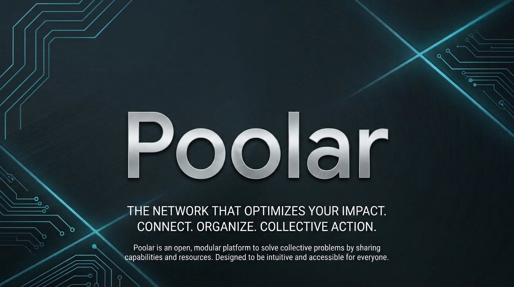
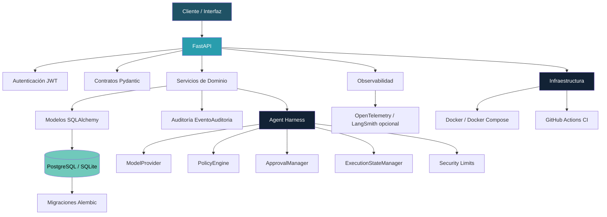
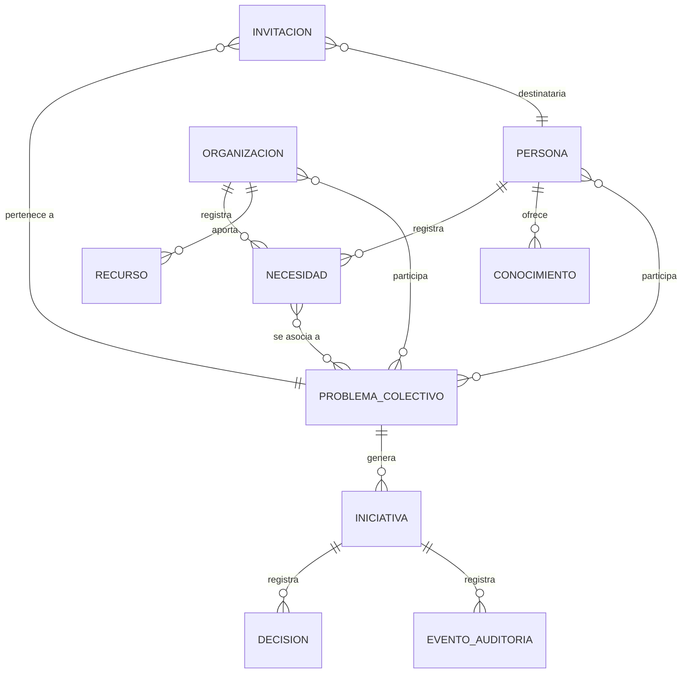
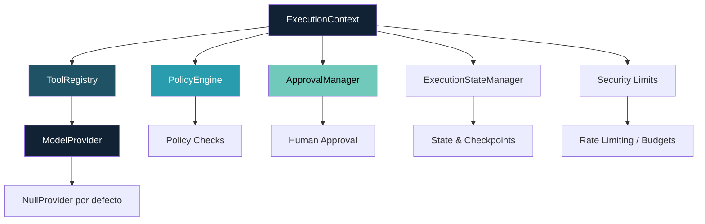

# Poolar — Infraestructura de Cooperación

<p align="center">
  
</p>

<p align="center">
  <strong>Conectar necesidades. Organizar capacidades. Construir soluciones compartidas.</strong>
</p>

<p align="center">
  <a href="#-que-es-poolar">Qué es</a> ·
  <a href="#-como-funciona">Cómo funciona</a> ·
  <a href="#-arquitectura">Arquitectura</a> ·
  <a href="#-modelo-de-dominio">Dominio</a> ·
  <a href="#-api-y-desarrollo">API</a> ·
  <a href="#-instalacion-y-ejecucion">Instalación</a> ·
  <a href="#-estado-del-proyecto">Estado</a>
</p>

<p align="center">
  
  
  
  
  
  
  
</p>

<p align="center">
  <strong>Topics:</strong> poolar, cooperacion, open-infrastructure, collective-problems, fastapi, sqlalchemy, postgresql, python, docker, agent-harness, matching, consent, accessibility
</p>

---

## Índice

- [Qué es Poolar](#-que-es-poolar)
- [El problema que resuelve](#-el-problema-que-resuelve)
- [Cómo funciona](#-como-funciona)
- [Arquitectura](#-arquitectura)
- [Modelo de dominio](#-modelo-de-dominio)
- [Agent Harness](#-agent-harness)
- [Funcionalidades](#-funcionalidades)
- [Escenario demostrativo](#-escenario-demostrativo-logistica-compartida)
- [Tecnologías](#-tecnologias)
- [API y desarrollo](#-api-y-desarrollo)
- [Instalación y ejecución](#-instalacion-y-ejecucion)
- [Estado del proyecto](#-estado-del-proyecto)
- [Documentación](#-documentacion)
- [Limitaciones conocidas](#-limitaciones-conocidas)

---

## Qué es Poolar

**Poolar** es una infraestructura abierta, modular e interoperable para la cooperación colectiva.

No es una red social, ni un gestor de tareas, ni un portal de anuncios. Es la capa que permite a personas, comunidades, asociaciones, cooperativas, pequeñas empresas e instituciones:

1. **Identificar** necesidades individuales y compartidas.
2. **Descubrir** problemas colectivos.
3. **Conectar** capacidades, conocimientos y recursos.
4. **Organizar** iniciativas y soluciones conjuntas.
5. **Documentar** decisiones y responsabilidades.
6. **Ejecutar** acciones coordinadas.
7. **Medir** resultados y generar aprendizajes reutilizables.

La unidad fundamental no es el usuario, la organización, la tarea ni el proyecto. Es **el problema que necesita una respuesta** y la **capacidad colectiva** que podemos reunir para resolverlo.

> Nadie tiene que llegar con una asociación constituida, conocer previamente a los demás ni saber qué aplicación necesita utilizar.

---

## El problema que resuelve

Personas y organizaciones tienen necesidades, conocimientos y recursos dispersos. Descubrir que comparten un problema, validar que existe una necesidad colectiva y organizarse para abordarlo requiere:

- **Descubrimiento**: encontrar a otras personas con necesidades compatibles.
- **Validación**: confirmar que el problema es real y compartido.
- **Agregación**: reunir demanda, capacidades y recursos.
- **Decisión**: comparar alternativas con criterios explícitos.
- **Coordinación**: asignar responsabilidades y ejecutar.
- **Trazabilidad**: registrar lo que se hizo y lo que se aprendió.

Poolar proporciona las herramientas operativas para ejecutar este proceso de forma abierta, transparente y reutilizable.

---

## Cómo funciona

El ciclo operativo de Poolar es:

```
Necesidad → Descubrimiento → Problema Colectivo → Capacidades y recursos → Alternativas → Decisión → Ejecución → Resultados → Aprendizaje reutilizable
```

### Recorrido típico

1. **Persona A** registra una necesidad: "Necesito transporte regular al centro de salud".
2. **Persona B** registra otra: "Necesito entregas para mi comercio".
3. El sistema **descubre coincidencias** potenciales por criterios deterministas (categoría, territorio, capacidades).
4. Se **revisa y acepta** la relación entre necesidades.
5. Se crea un **Problema Colectivo** que agrupa las necesidades.
6. Se **identifican capacidades** disponibles (conocimiento logístico, vehículos, etc.).
7. Se **comparan alternativas** (compartir ruta, agrupar demanda, contratar servicio).
8. Se **toma una decisión** documentada con responsables.
9. Se **registran hitos** de ejecución.
10. Se **mide el resultado** y se **exporta** el expediente.

---

## Arquitectura

### Arquitectura general



**Implementado:** FastAPI, SQLAlchemy, Pydantic, Auth JWT, Servicios, Modelos, Auditoría, Agent Harness (base), Observabilidad (adaptador), Docker, CI.
**Experimental:** Agent Harness (no conectado a flujo operativo), Observabilidad (desactivada por defecto).
**Futuro:** RAG, LangGraph, LangSmith, PostGIS, OR-Tools, MCP.

### Arquitectura de capas

```
┌─────────────────────────────────────────────┐
│  Interfaz (HTML/JS / Futuro: React)          │
├─────────────────────────────────────────────┤
│  API FastAPI (contratos Pydantic)           │
├─────────────────────────────────────────────┤
│  Servicios de Dominio (matching, needs,     │
│  invitation, aggregation, feasibility)      │
├─────────────────────────────────────────────┤
│  Núcleo de Dominio (models.py)              │
│  Persona · Organización · Necesidad ·       │
│  ProblemaColectivo · Iniciativa · Decision  │
│  · Invitacion · Recurso · Conocimiento      │
├─────────────────────────────────────────────┤
│  Persistencia (PostgreSQL / SQLite)         │
│  Migraciones (Alembic)                      │
└─────────────────────────────────────────────┘
```

---

## Modelo de dominio



### Entidades principales

| Entidad | Descripción |
|---|---|
| `Persona` | Participante individual con autenticación propia (`hashed_password`, `rol=individuo`). |
| `Organizacion` | Entidad colectiva con usuarios operativos. |
| `Necesidad` | Necesidad registrada por persona u organización (visibilidad: privada/compartible/pública). |
| `ProblemaColectivo` | Problema compartido que agrupa necesidades (estados: detectado → en_análisis → validado → cerrado). |
| `Iniciativa` | Solución organizada vinculada a un problema colectivo. |
| `Decision` | Decisión tomada con alternativa, motivo, responsable y versión de metodología. |
| `Invitacion` | Invitación persistente con estado (pendiente, aceptada, rechazada, retirada, caducada). |
| `ConocimientoCapacidad` | Conocimiento o capacidad ofrecida por persona u organización. |
| `RecursoAporte` | Recurso o aporte (tiempo, herramientas, materiales, etc.). |
| `EventoAuditoria` | Registro de eventos con actor, justificación, fecha y marcas de tiempo. |

---

## Agent Harness



El Agent Harness es una **base experimental**. No existe todavía un sistema de agentes plenamente integrado en el flujo operativo. El `ModelProvider` predeterminado es `NullProvider` (no realiza llamadas a modelos).

**Componentes implementados:**
- `ExecutionContext`: identidad, permisos, presupuesto, herramientas.
- `ToolRegistry`: registro tipado con contratos, permisos, límites.
- `PolicyEngine`: verificación de autorización en tiempo de ejecución.
- `ApprovalManager`: aprobaciones humanas.
- `ExecutionStateManager`: gestión de estado temporal.
- `Security`: límites de iteraciones, tool calls, timeout, presupuesto.

---

## Funcionalidades

### Implementadas (verificadas con tests)

| Capacidad | Estado | Descripción |
|---|---|---|
| Registro individual | ✅ | `POST /personas/registro` con validación, hash PBKDF2, rol fijo `individuo` |
| Auth dual | ✅ | JWT con `tipo` (individuo/organización), `get_current_user` por contexto |
| Problema Colectivo | ✅ | CRUD con integridad N:M, transiciones controladas, eventos de auditoría |
| Iniciativa | ✅ | Creación con responsable individual u organizativo |
| Invitación/Participación | ✅ | Persistente con consentimiento, estados (pendiente/aceptada/rechazada/retirada) |
| Matching determinista | ✅ | Coincidencias con criterios explícitos, incertidumbre, evidencia faltante |
| Exportación | ✅ | JSON/CSV con etiqueta `synthetic: true` |
| Auditoría | ✅ | Eventos con actor, justificación, fecha |
| Docker/Compose | ✅ | PostgreSQL 16 + API + migraciones |
| CI (configurado) | ⚙️ | GitHub Actions con PostgreSQL service. Verificado localmente; CI real pendiente de ejecución exitosa. |
| Interfaz funcional | ✅ | `interfaz/index.html` conectada a API |

### Base técnica experimental

| Componente | Estado | Nota |
|---|---|---|
| Agent Harness | 🔧 | Estructura definida, no conectado a flujo operativo |
| Model Provider | 🔧 | Adaptador con NullProvider por defecto |
| Seguridad transversal | 🔧 | Rate limiting, validación, redacción, detección de inyección |
| Observabilidad | 🔧 | Adaptador para OpenTelemetry/LangSmith (desactivado) |

### Roadmap (pendiente de implementación)

| Capacidad | Prioridad | Nota |
|---|---|---|
| PostgreSQL real | Alta | Servidor no disponible en este entorno |
| Playwright E2E | Alta | Configurado, ejecución pendiente |
| Consentimiento formal | Alta | Documentado, no implementado |
| Accesibilidad WCAG | Media | Guía base, no implementado |
| RAG + pgvector | Media | Pendiente de corpus y necesidad demostrada |
| LangGraph | Media | Documentado, pendiente de implementación |
| LangSmith/Langfuse | Baja | Documentado, pendiente de implementación |
| PostGIS, OR-Tools, MCP | Baja | Pendiente de necesidad demostrada |
| Integración repos auditados | Bloqueada | Hasta `P0`/`P1` corregidos |

---

## Escenario demostrativo: Logística compartida

Varias personas y pequeños comercios tienen dificultades para acceder a un servicio logístico adecuado. Cada participante tiene necesidades, limitaciones y capacidades diferentes.

El escenario incluye:

- **Persona A**: necesita transporte regular al centro de salud.
- **Persona B**: pequeño comercio que necesita entregas.
- **Persona C**: conocimientos logísticos disponibles.
- **Organización D**: podría aportar capacidad o negociar con proveedores.

El recorrido desde la interfaz:

1. Registrar necesidades (P1, P2, O4).
2. Descubrir coincidencias potenciales por criterios deterministas.
3. Revisar y aceptar/rechazar coincidencias.
4. Crear un Problema Colectivo con las necesidades pertinentes.
5. Identificar capacidades disponibles y recursos que faltan.
6. Comparar alternativas (compartir ruta, agrupar demanda, contratar servicio).
7. Crear una iniciativa para evaluar la posibilidad de compartir una ruta.
8. Registrar una decisión documentada.
9. Registrar hitos de ejecución (sintéticos, no resultados reales).
10. Consultar el historial y exportar el expediente.

> **Nota**: No se afirma que los participantes existen realmente, que una ruta se ha creado o que se ha conseguido ahorro real. Todos los datos son sintéticos (`synthetic_pilot`).

---

## Tecnologías

| Tecnología | Versión | Responsabilidad |
|---|---|---|
| Python | 3.11+ | Lenguaje principal |
| FastAPI | >=0.100 | API REST, contratos Pydantic |
| Pydantic | >=2.0 | Validación y serialización |
| SQLAlchemy | >=2.0 | ORM, modelos de dominio |
| PostgreSQL | 16 | Base de datos objetivo |
| SQLite | 3.x | Desarrollo y tests locales |
| Alembic | >=1.13 | Migraciones de base de datos |
| JWT (python-jose) | >=3.3 | Autenticación |
| PBKDF2-SHA256 | passlib | Hash de contraseñas |
| Pytest | >=7.0 | Pruebas automatizadas |
| Playwright | >=1.40 | Pruebas E2E de navegador |
| Docker | latest | Contenedores |
| Docker Compose | 3.9 | Orquestación local |

### Límites arquitectónicos

- **Monolito modular**: No hay microservicios ni infraestructura distribuida.
- **PostgreSQL como fuente de verdad**: SQLite solo para desarrollo controlado.
- **Agentes como adaptadores**: No sustituyen la autorización ni las decisiones del dominio.
- **Datos sintéticos obligatorios**: No se usan datos reales sin consentimiento documentado.

---

## API y desarrollo

### Endpoints principales

#### Autenticación
| Método | Ruta | Descripción |
|---|---|---|
| `POST` | `/personas/registro` | Registro individual (JSON body) |
| `POST` | `/auth/token` | Login (org o persona) |

#### Necesidades
| Método | Ruta | Descripción |
|---|---|---|
| `POST` | `/necesidades` | Registrar necesidad |
| `GET` | `/necesidades` | Listar necesidades accesibles |

#### Problemas Colectivos
| Método | Ruta | Descripción |
|---|---|---|
| `POST` | `/problemas-colectivos` | Crear problema (origen sintético) |
| `GET` | `/problemas-colectivos/{id}` | Consultar problema |
| `GET` | `/problemas-colectivos` | Listar problemas accesibles |
| `POST` | `/problemas-colectivos/{id}/estado` | Cambiar estado (con evidencia) |

#### Iniciativas
| Método | Ruta | Descripción |
|---|---|---|
| `POST` | `/iniciativas` | Crear iniciativa |
| `GET` | `/iniciativas/{id}` | Consultar iniciativa |
| `POST` | `/iniciativas/{id}/decisiones` | Registrar decisión |
| `POST` | `/iniciativas/{id}/actividades` | Registrar hito/actividad |
| `GET` | `/iniciativas/{id}/historial` | Timeline cronológico |

#### Invitaciones y participación
| Método | Ruta | Descripción |
|---|---|---|
| `POST` | `/problemas-colectivos/{id}/invitaciones` | Enviar invitación (JSON body) |
| `POST` | `/problemas-colectivos/{id}/participaciones` | Aceptar/rechazar participación (JSON body) |

#### Matching
| Método | Ruta | Descripción |
|---|---|---|
| `GET` | `/matching/necesidades-relacionadas` | Descubrir coincidencias |

#### Exportación
| Método | Ruta | Descripción |
|---|---|---|
| `GET` | `/exportar/necesidades` | Exportar necesidades (JSON) |
| `GET` | `/exportar/csv` | Exportar necesidades (CSV) |
| `GET` | `/exportar/iniciativa/{id}` | Exportar expediente completo (JSON) |

#### Auditoría
| Método | Ruta | Descripción |
|---|---|---|
| `POST` | `/eventos` | Registrar evento de auditoría |
| `GET` | `/health` | Health check |

### Documentación interactiva

- Swagger UI: `http://localhost:8000/docs`
- ReDoc: `http://localhost:8000/redoc`
- OpenAPI JSON: `http://localhost:8000/openapi.json`

---

## Instalación y ejecución

### Requisitos previos

- Python 3.11+
- Docker y Docker Compose (opcional, para PostgreSQL)
- PostgreSQL 16 (opcional, para pruebas de integración)

### Variables de entorno

Copiar `.env.example` a `.env` y ajustar:

```bash
cp .env.example .env
```

Variables requeridas:
- `POOLAR_SECRET_KEY` — secreto aleatorio para JWT (obligatorio, sin valor por defecto)
- `DATABASE_URL` — URL de conexión a la base de datos

Variables opcionales:
- `POOLAR_DEMO_MODE` — `true`/`false` (false por defecto)
- `CORS_ALLOW_ORIGINS` — orígenes permitidos para CORS
- `POOLAR_MODEL_PROVIDER` — proveedor de modelos (null por defecto)
- `POOLAR_TEST_POSTGRES_URL` — URL de PostgreSQL para tests de integración

### Instalación (desarrollo local)

```bash
# Crear entorno virtual
python -m venv .venv
.venv\Scripts\activate  # Windows
# source .venv/bin/activate  # macOS/Linux

# Instalar dependencias
pip install -r requirements.txt

# Ejecutar tests
python -m pytest tests/ -q

# Ejecutar tests E2E (Playwright + Chromium)
python -m pytest tests/e2e/ -q

# Iniciar API
python -m uvicorn src.main:app --reload --port 8000
```

### Docker Compose (PostgreSQL + API)

```bash
# Construir y levantar servicios
docker-compose up -d db
docker-compose up -d api

# Ver logs
docker-compose logs -f api

# Detener (conserva datos)
docker-compose down

# Restablecer datos (destructivo)
docker-compose down -v
```

### Migraciones PostgreSQL

```bash
# Aplicar migraciones
alembic upgrade head

# Verificar revisión
alembic current
```

### Nota sobre renombrado de directorio local

Si tu directorio local sigue llamándose `trama_abierta_mvp`, puedes renombrarlo de forma segura en Windows:

```powershell
# Cerrar todos los procesos (uvicorn, pytest, etc.)
# Luego renombrar
Rename-Item "C:\Users\JUAN\Desktop\Proyectos\Trama_Abierta\trama_abierta_mvp" "poolar"
# Actualizar la variable de entorno si es necesario
cd "C:\Users\JUAN\Desktop\Proyectos\Trama_Abierta\poolar"
```

No hay rutas absolutas duras en el código que dependan del nombre del directorio.

---

## Estado del proyecto

### Implementado (verificado con tests)

- Registro individual y login dual (persona/organización)
- Problema Colectivo con integridad N:M y transiciones controladas
- Iniciativa con responsable individual u organizativo
- Invitación/participación persistente con consentimiento
- Matching determinista con criterios explícitos e incertidumbre
- Decisiones, hitos y historial de iniciativas
- Exportación de expediente completo (JSON)
- Autorización dual (individuo/organización)
- Agent Harness (base experimental)
- Docker, CI, Alembic, interfaz funcional

### Base técnica experimental

- Agent Harness (estructura definida, no conectado a flujo operativo)
- Model Provider (adaptador con NullProvider por defecto)
- Seguridad transversal (rate limiting, validación, redacción)
- Observabilidad (adaptador desactivado por defecto)

### Roadmap (pendiente de implementación)

- PostgreSQL real (servidor no disponible en este entorno)
- Playwright E2E (configurado, ejecución pendiente)
- Consentimiento formal para datos reales
- Accesibilidad WCAG
- RAG + búsqueda semántica (pgvector)
- LangGraph (orquestación de flujos)
- LangSmith/Langfuse (observabilidad de IA)
- PostGIS, OR-Tools, MCP (cuando se demuestre necesidad)
- Integración con repos auditados (`P0`/`P1` corregidos)

---

## Documentación

| Documento | Contenido |
|---|---|
| [`docs/vision_y_proposito.md`](docs/vision_y_proposito.md) | Visión y propósito del MVP |
| [`docs/modelo_autorizacion.md`](docs/modelo_autorizacion.md) | Matriz de permisos por organización/persona/rol |
| [`docs/modelo_problemas_colectivos.md`](docs/modelo_problemas_colectivos.md) | Dominio, reglas, estado del código |
| [`docs/cat_herramientas.md`](docs/cat_herramientas.md) | Catálogo de herramientas operativas |
| [`docs/consentimiento.md`](docs/consentimiento.md) | Consentimiento y privacidad |
| [`docs/accesibilidad_wcag.md`](docs/accesibilidad_wcag.md) | Guía de accesibilidad |
| [`docs/hoja_de_ruta.md`](docs/hoja_de_ruta.md) | Hoja de ruta con pendientes |
| [`docs/auditoria_etapas.md`](docs/auditoria_etapas.md) | 10 etapas documentadas |
| [`docs/cierre_iteracion.md`](docs/cierre_iteracion.md) | Estado de entrega |
| [`docs/entrega_iteracion.md`](docs/entrega_iteracion.md) | Entregables |
| [`docs/registro_individual.md`](docs/registro_individual.md) | Restricciones de registro |
| [`docs/decisiones_tecnicas.md`](docs/decisiones_tecnicas.md) | Decisiones técnicas |
| [`docs/riesgos_pendientes.md`](docs/riesgos_pendientes.md) | Riesgos P0/P1 |
| [`docs/adr_langgraph_crewai.md`](docs/adr_langgraph_crewai.md) | ADR LangGraph vs CrewAI |
| [`docs/adr_langsmith_langfuse.md`](docs/adr_langsmith_langfuse.md) | ADR LangSmith vs Langfuse |
| [`docs/demo/escenario_logistica.md`](docs/demo/escenario_logistica.md) | Escenario de logística compartida |

---

## Limitaciones conocidas

- No incluye pagos ni custodia de fondos.
- No integra `Anexo_Risk`, `EnRuta` ni `CASE` hasta validar licencias y corregir `P0`/`P1`.
- `PostgreSQL` objetivo; `SQLite` solo para desarrollo controlado.
- No es producción; no afirma resultados de impacto sin evidencia.
- Datos sintéticos etiquetados; no usados como resultados reales.
- No declara "listo para producción"; no afirma impacto verificado sin evidencia.

---

## Licencia

MIT License. Ver [`LICENSE`](LICENSE).

---

<p align="center">
  <sub>Poolar — Infraestructura abierta de cooperación. Datos sintéticos hasta consentimiento formal.</sub>
</p>