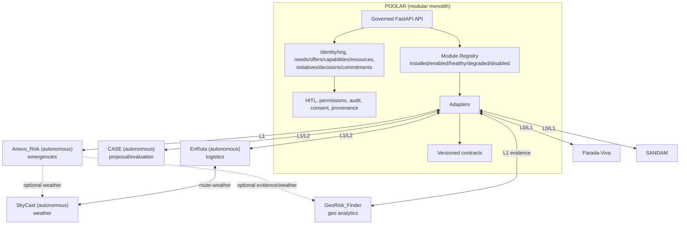
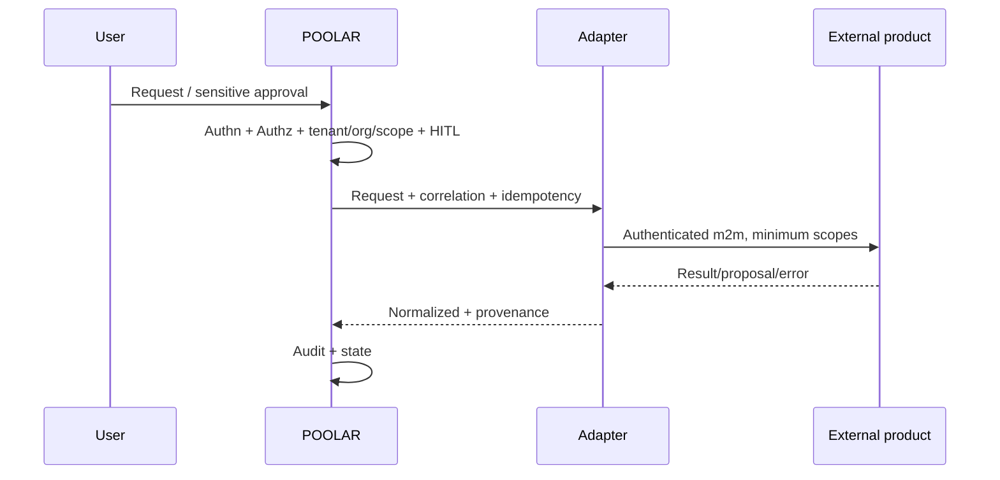
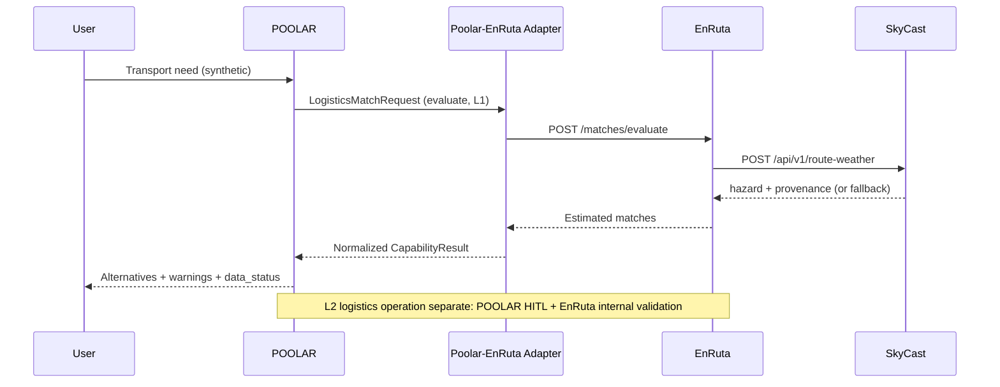

# POOLAR ECOSYSTEM — Architecture, Governance, and Product/Service Integration

**Date:** 2026-11-09  
**Updated:** 2026-11-10 (English translation/progressive alignment)  
**Status:** master strategy/design document recorded in repo (audit/design, **not implementation**).

**Method:** read-only local inspection of available clones (`POOLAR`, `CASE`, `EnRuta`, `SkyCast`, etc.), public `juandelaf1` GitHub pages, and prior audits as **historical, not revalidated** context unless stated. No repos were modified during the original analysis; no commits/branch changes/migrations/deployments; portfolio tests were not executed in that session.

## 1. Executive summary

POOLAR should be the **open core of governed cooperation** (identity in context, generic needs/capabilities/resources, initiatives, HITL decisions, commitments, audit, consent, provenance, capability registry). Specialized products connect as **autonomous** systems through **versioned contracts and adapters**, without shared databases or cross-repo ORM imports. **HITL/sensitive execution authority in POOLAR context:** always in POOLAR. CASE, EnRuta, SkyCast, Anexo_Risk, GeoRisk_Finder, Parada-Viva, SANDAM provide capabilities/evidence/proposals; they do not replace that authority.

## 2. Real-state diagnosis (evidence)

| Area | Observed state | Evidence | Level |
|---|---|---|---|
| POOLAR local | `fase0-gobernanza` (evolving), HITL/scope/idempotency/atomicity, module contracts/adapters (mock/synthetic), separated analytics, web MVP; formal Phase 0 closure, exhaustive authz, operational GDPR, stable real PG CI **pending** | code/docs + history | **Partial** |
| POOLAR CI | `ci.yml` (PG16, migrations, backend excluding e2e, Playwright e2e); `fase0-check.yml` (SQLite; `fase0-pg-real` `if:false`). Remote green execution **not verified** | local workflows | Config verified / execution not verified |
| CASE | Hexagonal, conservative evaluation, HITL/audit/policies. **Open discrepancy:** local README claimed 813 passed; prior public/historical audits cited 692. Baseline revalidated 2026-11-09: **806 passed, 7 skipped** (excluding streamlit client test as applicable) | README/history + local run evidence | **Documented / partially revalidated** |
| EnRuta | Dual autonomous+integrable. `POST /matches/evaluate` stateless, `logistics-l1/0.1`; `/matches/run`, `/health`. Synthetic data; public OSRM without SLA; cost/CO₂e estimated | local docs/README | **Partial/documented** |
| SkyCast | `POST /api/v1/route-weather` (`skycast-route-weather/0.1`), validate, health/capabilities; provenance; AEMET ES + Open-Meteo fallback | docs/README | **Partial/documented** |
| Anexo_Risk | Emergencies; overlap with orgs/needs/resources/alerts/decisions; license/attributions to review | public README | **Partial; IP/license risk** |
| GeoRisk_Finder | H3/clustering/scenario analytics; BCR/financial metrics = modeled scenarios, not observed | public README | **Experimental/analytical** |
| Parada-Viva | Revived base, no real partners/data | public README | **Early** |
| SANDAM | Beach API (FastAPI/async/PG/Haversine) | public README | **Technical MVP** |
| Licenses | MIT visible in several; **uncertain/unverified** in detail (Anexo_Risk, Devera_DS, SkyCast, AsesorIA, GeoRisk_Finder, forks/datasets) | GitHub | **Review required** |

## 3. Five fundamental architectural decisions

1. **POOLAR = cooperation core and sole HITL/sensitive-execution authority in its context.** External systems provide evaluation/evidence/proposals/results, not final approval of sensitive POOLAR actions.
2. **Product autonomy** + optional integration levels **L0→L1→L2→L3** (future federation).
3. **No shared DB, no cross-repo ORM imports.** Exchange via APIs/contracts, mapped IDs, provenance.
4. **Modular monolith in POOLAR + adapters + autonomous products/services.** No microservices by default.
5. **Explicit governance:** distinguish authentication, authorization, delegation, approval, and execution; tenant/org/scope, idempotency, correlation, versioning, audit, safe degradation.

## 4. Critical risks

| Risk | Mitigation |
|---|---|
| Dual CASE/POOLAR authority | CASE proposal-only; final HITL/audit in POOLAR |
| Incomplete multi-tenant authorization | Authz matrix per endpoint/adapter, negative tests, minimum scopes |
| Uncertain licenses/IP | Verify LICENSE/deps/attributions before merging code |
| Synthetic/estimated data misinterpreted | `data_status`, provenance, disclaimers, separate evaluation/execution |
| External dependencies (OSRM/AEMET/Open-Meteo) | timeout, explicit fallback, circuit breaker, governed cache |
| GDPR/consent incomplete | minimization, retention, DSAR/export/deletion, PII classification |
| Premature complexity | start at L1, minimal contracts, modular monolith |

## 5. Recommended architecture

## 6. First integration to develop

**POOLAR + EnRuta + SkyCast, L1 governed logistics evaluation with synthetic data** (no real operational execution). Base contracts: `logistics-l1/0.1` and `skycast-route-weather/0.1`. Strictly separate evaluation vs operation.

## Deliverable A — Inventory (verifiable summary)

| Project | Domain | Classification | Maturity | Autonomy | POOLAR relation | Evidence | Key uncertainty |
|---|---|---|---|---|---|---|---|
| POOLAR | cooperation | PLATFORM/CORE | prototype | high | core | local code/config | Phase 0, authz, GDPR |
| CASE | AI evaluation | PRODUCT/CAPABILITY | technical product | high | proposal-only | README/local runs | contract hardening, live-provider env |
| EnRuta | rural logistics | PRODUCT+MODULE | simulated MVP | high | L1/L2 logistics | local docs | real data, m2m, SLA |
| SkyCast | weather/risk | CAPABILITY SERVICE | partial | high | shared capability | docs/README | license, resilience |
| Anexo_Risk | emergencies | vertical product | prototype | high | coordination | public README | IP/license, overlap |
| GeoRisk_Finder | geo analytics | ANALYTICS | experimental | high | evidence | public README | operational validity |
| Parada-Viva | territory/commerce | PRODUCT | early | high | connector | README | data/PII/payments |
| SANDAM | beaches | PRODUCT/CAPABILITY | technical MVP | high | specific | README | real integration |
| DashLogistics | logistics analytics | ANALYTICS | exploration | high | non-priority | local README | predictive limits |
| RASPAL_SCRAPER | extraction | TOOL | mature | high | internal tool | README | legality/PII |
| AsesorIA | fiscal RAG | PRODUCT | independent | high | not core | README | domain/license |
| Devera_DS | LCA | EXPERIMENT | experimental | high | do not integrate | README | **IP/license/data** |
| Others/archived | various | RESEARCH/ARCHIVED | variable | high/n/a | not now | GitHub/local | low utility/obsolescence |

Private/inaccessible repos: **unknown**.

## Deliverable B — Domain map and responsibilities

| Capability/data | Owner | Conflict/overlap | Decision |
|---|---|---|---|
| Cooperative identity, orgs, memberships, roles, scopes (POOLAR context) | POOLAR | local auth in products | canonical in integrated mode; local in standalone |
| Generic needs/offers/capabilities/resources | POOLAR | modeled in verticals | generic core + refs/extensions |
| Initiatives, decisions, commitments, cooperation audit | POOLAR | CASE/Anexo own decisions | separate POOLAR cooperation vs internal product domain |
| Conservative AI evaluation | CASE | HITL/policy overlap | CASE evaluates; POOLAR authorizes/executes |
| Matching/routes/capacity/cost/CO₂e | EnRuta | reimplementation in POOLAR | delegate by contract |
| Route weather/risk | SkyCast | dispersed logic | shareable service |
| Emergency incidents/response | Anexo_Risk | overlap with generic entities | Anexo operational; POOLAR generic coordination |
| Geo analytics/models | GeoRisk_Finder | confusion with operational authority | versioned evidence with uncertainty |
| Local catalog/services | Parada-Viva | offers/territory | autonomous connected |
| Beach management | SANDAM | niche | autonomous connected |

## Deliverable C — Current architecture

Products mostly autonomous; real external integrations limited/mock; independent persistence.

## Deliverable D — Target architecture

See section 5 diagram. Layers: **POOLAR Core** (identity/org/roles, needs/resources, initiatives/decisions/commitments, approvals, audit, consent, registry) → **Contracts** (versioned, typed, provenance) → **Adapters** (translation, m2m auth, scopes, validation, timeouts, correlation) → **Autonomous products** → **Optional external connectors**.

## Deliverable E — Contract design

### Common envelope
Minimum fields: `module_id`, `module_version`, `contract_version`, `capability_id`, `caller`, `tenant_context`, `organization_context`, `scopes`, `correlation_id`, `idempotency_key`, `data_classification`, `provenance`, `requested_at`, `locale`, `payload_version`, `payload`.

### Normalized errors
`AUTHENTICATION_ERROR`, `AUTHORIZATION_ERROR`, `CONTRACT_INCOMPATIBLE`, `INVALID_DATA`, `CAPABILITY_UNAVAILABLE`, `TIMEOUT`, `IDEMPOTENCY_CONFLICT`, `PROVIDER_INTERNAL_ERROR`, `OPERATION_REJECTED`, `APPROVAL_PENDING` (+ `retryable`, `correlation_id`).

### Typed domain contracts
- `LogisticsMatchRequest/Response` — aligned with EnRuta `logistics-l1/0.1` (`/matches/evaluate`, stateless).
- `RouteWeatherRequest/Response` — aligned with SkyCast `skycast-route-weather/0.1`.
- `CaseEvaluationRequest/Response` — evaluation/risk/recommendation/evidence; **no POOLAR execution authorization**.
- `RiskAssessmentRequest/Response` — versioned evidence, `data_status=modelled/observed/mixed`, uncertainty/disclaimer.

### Versioning
Contract SemVer. MAJOR incompatible. Consumer declares supported version; provider returns `CONTRACT_INCOMPATIBLE` if not applicable. Deprecation window and metrics. Contract tests + golden fixtures + compatibility matrix.

## Deliverable F — Identity and governance

Distinguish: **authentication** (who), **authorization** (what allowed), **delegation** (on whose behalf), **approval** (who authorizes sensitive action), **execution** (which system acts). Progressive strategy: local auth + m2m scopes (L1) → JWT/OIDC/bounded delegation (L2) → federation (L3 future). Threats: IDOR/BOLA, privilege escalation, tenant confusion, service impersonation, replay, broad delegation, duplicate retries, execution without valid HITL. Mandatory authz test matrix.

## Deliverable G — POOLAR + EnRuta + SkyCast (reference)

**L1 acceptance:** valid contract; no real operation; `contract_version`/`correlation_id`/`idempotency_key`/`data_status`/provenance; safe degradation if SkyCast fails; no duplicates on retry; audit without PII.

## Deliverable H — Subsequent integrations

| Integration | Rule | Risk |
|---|---|---|
| POOLAR+CASE | CASE evaluates; POOLAR decides/authorizes/executes in its context | dual governance |
| POOLAR+Anexo+GeoRisk(+SkyCast) | Anexo operational; GeoRisk evidence; POOLAR generic coordination | domain/sensitive-data overlap |
| POOLAR+Parada-Viva | catalog/offers/territory via adapter; do not assume real operation | PII/maturity |
| POOLAR+SANDAM | specific territorial capability | limited scope |
| Others | integrate only with clear benefit; RASPAL only as controlled tool | cost/IP/legal |

## Deliverable I — Security, privacy, and operations

Threats: IDOR/BOLA, escalation, tenant confusion, m2m impersonation, replay, broad delegation, compromised provider, PII leakage, sensitive execution without HITL, unknown state. Controls: TLS, managed secrets, minimum scopes, I/O validation, rate limiting, structured logs, audit, SBOM/scanning, health/backups/restore, rotation, reconciliation by `correlation_id/idempotency_key`. Offline: **no** offline approval/execution of sensitive actions. GDPR: minimization, purpose limitation, retention, export/deletion, consent (requires legal review for formal compliance).

## Deliverable J — Testing strategy

Product, contract, integration, security (authz/tenant/IDOR), resilience (timeouts/partial failures), idempotency, version interoperability, UX/accessibility. Do not use README test counts as quality. Distinguish existing/executed/approved/skipped/failed/external.

## Deliverable K — Roadmap

| Horizon | Priority | Deliverables | Criteria |
|---|---|---|---|
| 0–30 days | Contracts/manifest/ADRs, license inventory, POOLAR authz matrix | `ModuleManifest` v0, envelope+errors, CASE/POOLAR ADR | validated schemas, classified IP risks |
| 31–90 days | L1 POOLAR+EnRuta+SkyCast, CASE proposal-only, CI/PG hardening | adapters, contract tests, observability, degradation | L1 criteria met, no L2 execution |
| 91–180 days | Governed vertical pilot + 1 selected external connector | scoped pilot, runbooks, basic accessible UX | complete audit, metrics, synthetic/authorized data |
| 181–365 days | Stable ecosystem, reproducible self-host, governance/licenses | 3–4 integrations, ops docs, security review | reproducible deployments, legal/IP review |

## Deliverable L — Technical backlog (P0 extract)

- **B-001** Common envelope + errors (POOLAR/docs).
- **B-002** `ModuleManifest` v0.
- **B-003** Authz matrix for critical endpoints/adapters.
- **B-004** L1 EnRuta evaluation adapter (mock/sandbox/synthetic).
- **B-005** SkyCast degradation/provenance handling.
- **B-006** End-to-end correlation/idempotency.
- **B-007** CASE–POOLAR boundary ADR.
- **B-008** License/IP/deps/data inventory.

## Deliverable M — ADRs (summary)

| ADR | Decision | Status |
|---|---|---|
| ADR-001 | POOLAR core + autonomous products | proposed |
| ADR-002 | No shared DB or cross-repo ORM | proposed |
| ADR-003 | POOLAR HITL/execution authority in its context | proposed |
| ADR-004 | Modular monolith first | proposed |
| ADR-005 | L1 before L2 | proposed |
| ADR-006 | Versioned contracts + provenance/data_status | proposed |
| ADR-007 | Progressive identity (m2m→OIDC→federation) | pending validation |

## Next implementation step (proposal, not implemented)

**L1-EVAL-SYNTH:** governed logistics evaluation with synthetic data `POOLAR → EnRuta (/matches/evaluate, logistics-l1/0.1) → SkyCast (route-weather)`. Exclude real execution, L2, personal data, permission changes, execution approvals. Acceptance: valid schema, `contract_version/correlation_id/idempotency_key/data_status/provenance`, no duplication on retry, safe degradation, contract+security tests, audit without PII. **Requires explicit authorization before implementation.**
