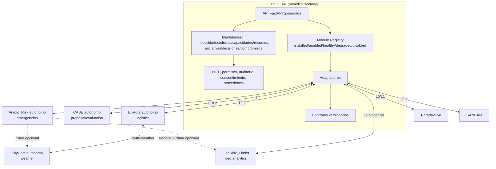
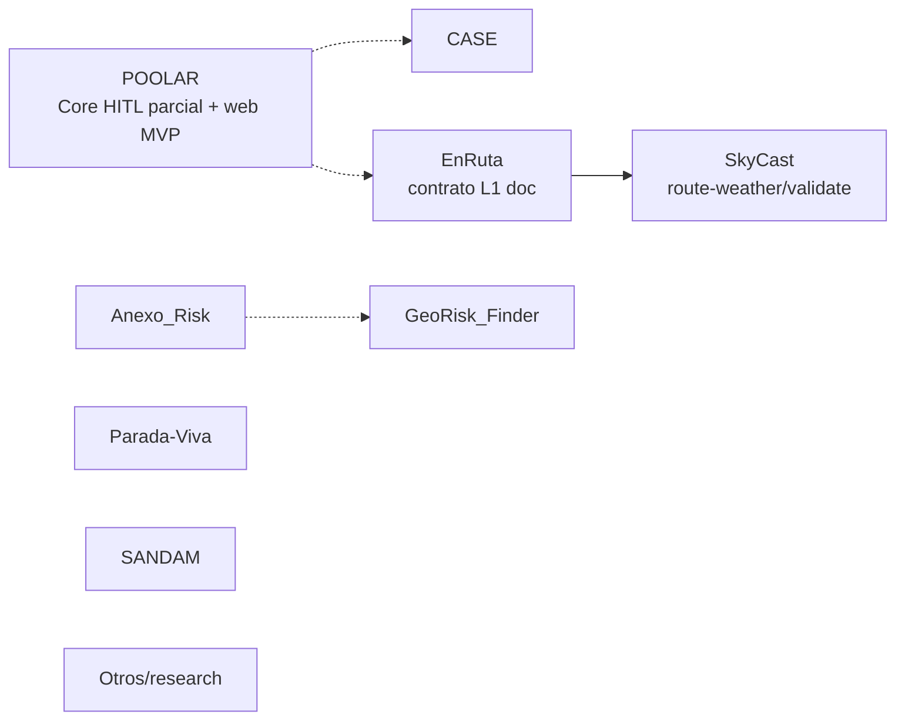
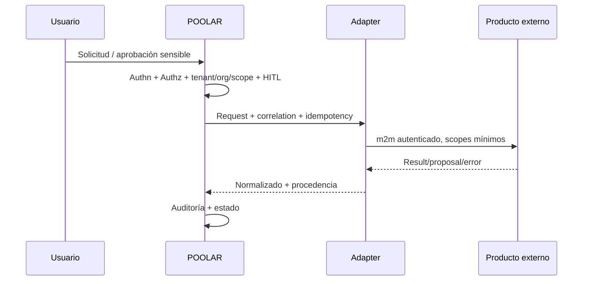
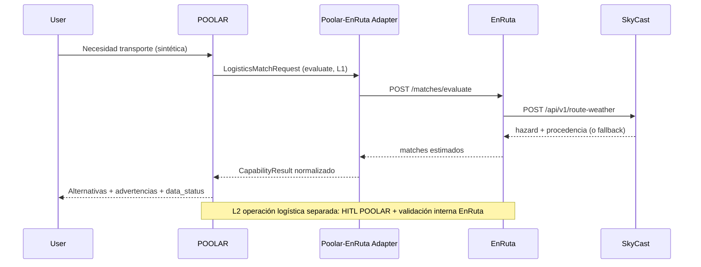

# POOLAR ECOSYSTEM — Arquitectura, Gobernanza e Integración de Productos y Servicios

**Fecha:** 2026-11-09  
**Estado:** documento maestro registrado en repo a solicitud del usuario (auditoría/diseño, **no implementación**).  
**Método:** inspección local read-only de clones disponibles (`POOLAR`, `CASE`, `EnRuta`, `SkyCast`, etc.), páginas públicas GitHub `juandelaf1`, y auditorías previas como contexto histórico **no revalidado** salvo indicación. **No se modificaron repos durante el análisis; no commits/cambios de rama/migraciones/despliegues; no se ejecutaron tests del portfolio en esa sesión.**

## 1. Resumen ejecutivo
POOLAR debe ser el **núcleo abierto de cooperación gobernada** (identidad organizativa en contexto, necesidades/capacidades/recursos genéricos, iniciativas, decisiones HITL, compromisos, auditoría, consentimiento, procedencia, registro de capacidades). Los productos especializados se conectan como **autónomos** mediante **contratos versionados y adaptadores**, sin compartir bases de datos ni importar ORM entre repos. **Autoridad HITL/ejecución sensible en contexto POOLAR:** siempre en POOLAR. CASE, EnRuta, SkyCast, Anexo_Risk, GeoRisk_Finder, Parada-Viva, SANDAM aportan capacidades/evidencias/propuestas; no sustituyen esa autoridad.

## 2. Diagnóstico del estado real (evidencia)

| Área | Estado observado | Evidencia | Nivel |
|---|---|---|---|
| POOLAR local | `fase0-gobernanza@9ddc834096d1bd86e39f9ef32d6ffbf61452f32f`, árbol sucio (M: `tests/test_p01_persistencia.py`, `web/src/App.tsx`, `web/src/api/types.ts`; ?? `fix_regresion.py`, `web/src/pages/Flujo.tsx`, `web/src/pages/Necesidades.tsx`) | git local | **Verificado** |
| POOLAR CI | `ci.yml` (PG16, migraciones, backend sin e2e, e2e Playwright); `fase0-check.yml` (SQLite; `fase0-pg-real` `if:false`). Ejecución remota verde **no verificada** | workflows locales | Config verificada / ejecución no verificada |
| POOLAR capacidades | HITL/scope/idempotencia/atomicidad, contratos/adaptadores mock, analytics separado, web MVP; Fase 0 cierre formal, authz exhaustiva, RGPD operativo, PG CI real estables **pendientes** | código/docs + histórico | **Parcial** |
| CASE | Hexagonal, evaluación conservadora, HITL/auditoría/políticas (README local). **Discrepancia abierta:** README local declara “813 passed”; versión pública histórica citada en auditorías previas mostraba “692”. **No revalidado** | README local + prompt | **Documentado, no revalidado** |
| EnRuta | Dual autónomo+acoplable. `docs/CONTRATO_LOGISTICO_POOLAR.md`: `POST /matches/evaluate` stateless, `contract_version=logistics-l1/0.1`; `/matches/run`, `/health`. Datos sintéticos; OSRM público sin SLA; coste/CO₂ estimados | docs locales/README | **Parcial/documentado** |
| SkyCast | `POST /api/v1/route-weather` (`skycast-route-weather/0.1`), `/validate`, health/capabilities; procedencia; AEMET ES + fallback Open-Meteo | docs/README local | **Parcial/documentado** |
| Anexo_Risk | Emergencias; solapa orgs/necesidades/recursos/alertas/decisiones; LICENSE/atribuciones a revisar | README público | **Parcial; riesgo IP/licencia** |
| GeoRisk_Finder | Analytics H3/clustering/escenarios; BCR/métricas financieras = modelo/escenarios, no observadas | README público | **Experimental/analítico** |
| Parada-Viva | Base revivida, sin partners/datos reales | README público | **Temprano** |
| SANDAM | API playas FastAPI async/PG/Haversine | README público | **MVP técnico** |
| Licencias | MIT visibles en varios; **inciertas/no verificadas** en detalle (Anexo_Risk, Devera_DS, SkyCast, AsesorIA, GeoRisk_Finder, forks/datasets) | GitHub | **Revisión requerida** |

## 3. Cinco decisiones arquitectónicas fundamentales
1. **POOLAR = núcleo de cooperación y única autoridad HITL/ejecución en su contexto.** Externos: evaluación/evidencia/propuesta/resultado, no aprobación final de acciones sensibles de POOLAR.
2. **Autonomía por producto** + integración opcional L0→L1→L2→L3 (federación futura).
3. **Sin DB compartida, sin imports ORM cross-repo.** Intercambio por API/contratos, IDs mapeados, procedencia.
4. **Monolito modular en POOLAR + adaptadores + productos/servicios autónomos.** No microservicios por defecto.
5. **Gobernanza explícita:** diferenciar autenticación, autorización, delegación, aprobación y ejecución; tenant/org/scope, idempotencia, correlación, versionado, auditoría, degradación segura.

## 4. Riesgos críticos
| Riesgo | Mitigación |
|---|---|
| Doble autoridad CASE/POOLAR | CASE proposal-only; HITL/auditoría final en POOLAR |
| Autorización multi-tenant incompleta | Matriz authz endpoint/adapter, tests negativos, scopes mínimos |
| Licencias/IP inciertas | Verificar LICENSE/deps/atribuciones antes de fusionar código |
| Datos sintéticos/estimaciones mal interpretados | `data_status`, procedencia, disclaimers, separar evaluación/ejecución |
| Dependencias externas (OSRM/AEMET/Open-Meteo) | timeout, fallback explícito, circuit breaker, caché gobernada |
| RGPD/consentimiento incompleto | minimización, retención, DSAR/export/borrado, clasificación PII |
| Complejidad prematura | empezar L1, contratos mínimos, monolito modular |

## 5. Arquitectura recomendada

## 6. Primera integración a desarrollar
**POOLAR + EnRuta + SkyCast, L1 evaluación logística gobernada con datos sintéticos** (sin ejecución operativa real). Contratos base: `logistics-l1/0.1` y `skycast-route-weather/0.1`. Separar estrictamente evaluación vs operación.

## ENTREGABLE A — Inventario (síntesis verificable)
| Proyecto | Dominio | Clasificación | Madurez | Autonomía | Relación POOLAR | Evidencia | Incertidumbre clave |
|---|---|---|---|---|---|---|---|
| POOLAR | cooperación | PLATFORM/CORE | prototipo | alta | core | código/config local | Fase 0, authz, RGPD |
| CASE | evaluación IA | PRODUCT/CAPABILITY | producto técnico | alta | proposal-only | README local | tests 813/692, contrato |
| EnRuta | logística rural | PRODUCT+MODULE | MVP simulado | alta | L1/L2 logística | docs locales | datos reales, m2m, SLA |
| SkyCast | clima/riesgo | CAPABILITY SERVICE | parcial | alta | capacidad compartida | docs/README | licencia, resiliencia |
| Anexo_Risk | emergencias | PRODUCT vertical | prototipo | alta | coordinación | README público | IP/licencia, solapamiento |
| GeoRisk_Finder | geo analytics | ANALYTICS | experimental | alta | evidencia | README público | validez operativa |
| Parada-Viva | territorio/comercio | PRODUCT | temprano | alta | conector | README | datos/PII/pagos |
| SANDAM | playas | PRODUCT/CAPABILITY | MVP técnico | alta | puntual | README | integración real |
| DashLogistics | analytics logística | ANALYTICS | exploración | alta | no prioritaria | README local | R² no predictivo real |
| RASPAL_SCRAPER | extracción | TOOL | madura | alta | herramienta interna | README | legalidad/PII |
| AsesorIA | RAG fiscal | PRODUCT | independiente | alta | no core | README | dominio ajeno/licencia |
| Devera_DS | LCA | EXPERIMENT | experimental | alta | no integrar | README | **IP/licencia/datos** |
| FitFamily/DataScope/NetTension/Attention/Optimus/Golden/ONCE-UPON-A-90S/EDA | varios | RESEARCH | variable | alta | no integrar ahora | GitHub/local | utilidad baja |
| Archivados | histórico | ARCHIVED | histórico | n/a | no integrar | GitHub | obsolescencia |
**Privados/no accesibles:** `DESCONOCIDO`. **Locales no mapeados:** inventario aparte.

## ENTREGABLE B — Mapa de dominios y responsabilidades
| Capacidad/dato | Propietario | Conflicto/solapamiento | Decisión |
|---|---|---|---|
| Identidad cooperativa, orgs, membresías, roles, ámbitos (contexto POOLAR) | POOLAR | auth local productos | POOLAR canónico en integrado; local en standalone |
| Necesidades/ofertas/capacidades/recursos genéricos | POOLAR | Anexo/Parada modelan similares | Core genérico + refs/extensiones |
| Iniciativas, decisiones, compromisos, auditoría cooperación | POOLAR | CASE/Anexo decisiones propias | separar cooperación POOLAR vs dominio interno producto |
| Evaluación conservadora IA | CASE | HITL/políticas solapadas | CASE evalúa; POOLAR autoriza/ejecuta |
| Matching/rutas/capacidad/coste/CO₂ | EnRuta | reimplementación en POOLAR | delegar por contrato |
| Clima/riesgo ruta | SkyCast | lógica dispersa | servicio compartible |
| Incidentes/respuesta emergencias | Anexo_Risk | entidades genéricas con POOLAR | Anexo operativo; POOLAR coordinación genérica |
| Geo analytics/modelos | GeoRisk_Finder | confusión con autoridad operativa | evidencia versionada con incertidumbre |
| Catálogo/servicios locales | Parada-Viva | ofertas/territorio | autónomo conectado |
| Gestión playas | SANDAM | nicho | autónomo conectado |

## ENTREGABLE C — Arquitectura actual

Productos mayormente autónomos; integraciones reales externas limitadas/mock; persistencias independientes.

## ENTREGABLE D — Arquitectura objetivo
Ver diagrama sección 5. Capas: **Núcleo POOLAR** (identidad/org/roles, necesidades/recursos, iniciativas/decisiones/compromisos, aprobaciones, auditoría, consentimiento, registry) · **Contratos** (versionados, tipados, procedencia) · **Adaptadores** (traducción, auth m2m, scopes, validación, timeouts, correlación) · **Productos autónomos** · **Conectores externos opcionales**.

## ENTREGABLE E — Diseño de contratos

### Sobre común
Campos mínimos: `module_id`, `module_version`, `contract_version`, `capability_id`, `caller`, `tenant_context`, `organization_context`, `scopes`, `correlation_id`, `idempotency_key`, `data_classification`, `provenance`, `requested_at`, `locale`, `payload_version`, `payload`.

### Errores normalizados
`AUTHENTICATION_ERROR`, `AUTHORIZATION_ERROR`, `CONTRACT_INCOMPATIBLE`, `INVALID_DATA`, `CAPABILITY_UNAVAILABLE`, `TIMEOUT`, `IDEMPOTENCY_CONFLICT`, `PROVIDER_INTERNAL_ERROR`, `OPERATION_REJECTED`, `APPROVAL_PENDING` (+ `retryable`, `correlation_id`).

### Contratos tipados (dominio)
- `LogisticsMatchRequest/Response` — alineado con EnRuta `logistics-l1/0.1` (`/matches/evaluate`, stateless). 
- `RouteWeatherRequest/Response` — alineado con SkyCast `skycast-route-weather/0.1`. 
- `CaseEvaluationRequest/Response` — evaluación/riesgo/recomendación/evidencia; **sin autorización de ejecución POOLAR**. 
- `RiskAssessmentRequest/Response` — evidencia versionada, `data_status=modelled/observed/mixed`, incertidumbre/disclaimer.

### Versionado
SemVer contrato. MAJOR incompatible. Consumidor declara versión soportada; proveedor responde `CONTRACT_INCOMPATIBLE` si no aplica. Deprecación con ventana y métricas. Contract tests + golden fixtures + matriz compatibilidad.

## ENTREGABLE F — Identidad y gobernanza
Distinguir: **autenticación** (quién), **autorización** (qué puede), **delegación** (en nombre de quién), **aprobación** (quién autoriza acción sensible), **ejecución** (qué sistema actúa). Estrategia progresiva: auth local + m2m scopes (L1) → JWT/OIDC/delegación acotada (L2) → federación (L3 futura). Amenazas: IDOR/BOLA, escalado, confusión tenant, suplantación servicio, replay, delegación amplia, reintentos duplicados, ejecución sin HITL válido. Matriz de pruebas authz obligatoria.

## ENTREGABLE G — POOLAR + EnRuta + SkyCast (referencia)

**Aceptación L1:** contrato válido; sin operación real; `contract_version`/`correlation_id`/`idempotency_key`/`data_status`/procedencia; degradación segura si SkyCast falla; sin duplicados por reintento; auditoría sin PII.

## ENTREGABLE H — Integraciones posteriores
| Integración | Regla | Riesgo |
|---|---|---|
| POOLAR+CASE | CASE evalúa; POOLAR decide/autoriza/ejecuta en su contexto | doble gobernanza |
| POOLAR+Anexo+GeoRisk(+SkyCast) | Anexo operativo; GeoRisk evidencia; POOLAR coordinación genérica | solapamiento dominio/datos sensibles |
| POOLAR+Parada-Viva | catálogo/ofertas/territorio por adapter; no asumir operación real | PII/madurez |
| POOLAR+SANDAM | capacidad territorial puntual | alcance limitado |
| Resto | integrar solo con beneficio claro; RASPAL solo herramienta controlada | coste/IP/legal |

## ENTREGABLE I — Seguridad, privacidad y operación
Amenazas: IDOR/BOLA, escalado, confusión tenant, suplantación m2m, replay, delegación amplia, proveedor comprometido, fuga PII, ejecución sensible sin HITL, estado desconocido. Controles: TLS, secretos gestionados, scopes mínimos, validación E/S, rate limit, logs estructurados, auditoría, SBOM/escaneo, health/backups/restore, rotación, reconciliación por `correlation_id/idempotency_key`. Offline: **no** aprobar/ejecutar acciones sensibles offline. RGPD: minimización, finalidad, retención, exportación/supresión, consentimiento (requiere revisión jurídica para cumplimiento formal).

## ENTREGABLE J — Estrategia de pruebas
Producto, contrato, integración, seguridad (authz/tenant/IDOR), resiliencia (timeouts/fallos parciales), idempotencia, interoperabilidad de versiones, UX/accesibilidad. No usar counts de tests de README como calidad. Distinguir existente/ejecutado/aprobado/omitido/fallido/externo.

## ENTREGABLE K — Roadmap
| Horizonte | Prioridad | Entregables | Criterios |
|---|---|---|---|
| 0–30 días | Contratos/manifest/ADRs, inventario licencias, matriz authz POOLAR | `ModuleManifest` v0, envelope+errores, ADR CASE/POOLAR | schemas validados, riesgos IP clasificados |
| 31–90 días | L1 POOLAR+EnRuta+SkyCast, CASE proposal-only, CI/PG hardening | adapters, contract tests, observabilidad, degradación | criterios L1 cumplidos, sin ejecución L2 |
| 91–180 días | Piloto vertical gobernado + 1 conector externo seleccionado | piloto acotado, runbooks, UX accesible básica | auditoría completa, métricas, datos sintéticos/autorizados |
| 181–365 días | Ecosistema estable, self-host reproducible, gobernanza/licencias | 3-4 integraciones, docs ops, seguridad revisada | despliegues reproducibles, revisión legal/IP |

## ENTREGABLE L — Backlog técnico (extracto P0)
- **B-001** Envelope común + errores (POOLAR/docs). 
- **B-002** `ModuleManifest` v0. 
- **B-003** Matriz authz endpoints/adapters críticos. 
- **B-004** Adapter L1 EnRuta evaluación (mock/sandbox/sintético). 
- **B-005** Degradación SkyCast/procedencia. 
- **B-006** Correlation/idempotency end-to-end. 
- **B-007** ADR frontera CASE-POOLAR. 
- **B-008** Inventario licencias/IP/deps/datos.

## ENTREGABLE M — ADRs (resumen)
| ADR | Decisión | Estado |
|---|---|---|
| ADR-001 | Núcleo POOLAR + productos autónomos | propuesta |
| ADR-002 | Sin DB compartida ni ORM cross-repo | propuesta |
| ADR-003 | Autoridad HITL/ejecución POOLAR en su contexto | propuesta |
| ADR-004 | Monolito modular primero | propuesta |
| ADR-005 | L1 antes de L2 | propuesta |
| ADR-006 | Contratos versionados + procedencia/data_status | propuesta |
| ADR-007 | Identidad progresiva (m2m→OIDC→federación) | pendiente validación |

## PRÓXIMO PASO DE IMPLEMENTACIÓN (propuesta, no implementada)
**L1-EVAL-SYNTH:** evaluación logística gobernada con datos sintéticos `POOLAR→EnRuta(/matches/evaluate, logistics-l1/0.1)→SkyCast(route-weather)`. Excluir ejecución real, L2, datos personales, cambios de permisos, aprobaciones de ejecución. Aceptación: esquema válido, `contract_version/correlation_id/idempotency_key/data_status/procedencia`, no duplicación por reintento, degradación segura, tests contrato+seguridad, auditoría sin PII. **Requiere autorización explícita antes de implementar.**
